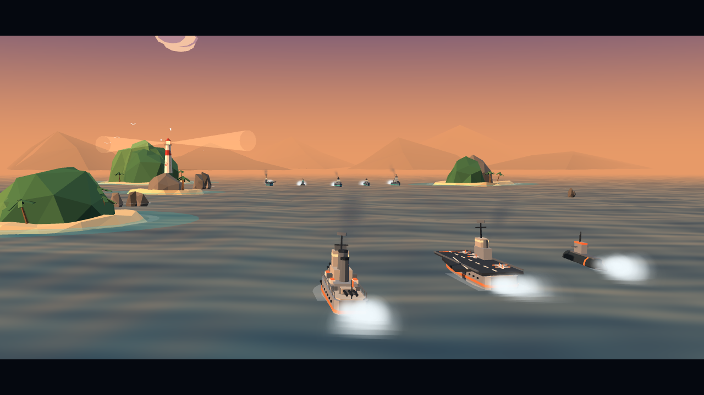
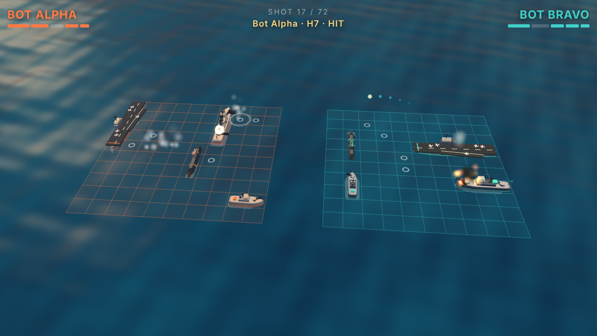
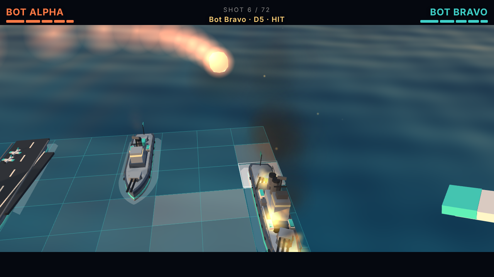

# Battleship AI Hackathon: 3D Replay Viewer

Two Battleship bots play each other, and this project turns the match into a
naval battle you can watch: fleets sail in, shells arc across the water, ships
burn and sink.

**[Watch it live](https://tdrobertson.github.io/battleship-hackathon-render/viewer/)**
(click once to start it with sound).



It started as a club hackathon where members wrote Battleship bots and ran them
against each other. This repository adds a way to *show* a match, so it can be
recorded and shared.





## What it does

1. **Record.** `scripts/export_replay.py` runs one match between any two bots
   and saves a replay: where each bot placed its ships, every shot in order
   with its result, and the winner.
2. **Play back.** `viewer/index.html` reads that replay and animates it in the
   browser. Nothing in the viewer decides the game; it only follows the
   recorded shots.

The viewer is a single HTML file using [Three.js](https://threejs.org/). The
ships, water and effects are all generated in code, so there are no models or
textures to download. Sound uses a few public-domain recordings layered with
synthesised effects.

What you see during a match:

- **Opening.** A waterline shot looking up at a battleship as it sails into
  frame, then a long-lens view down the line of advance with the enemy fleet on
  the horizon, before the camera climbs away to the aerial view.
- **Sail-in.** Both fleets arrive in formation and curve onto the positions
  the bots chose, and each carrier launches its aircraft, which circle over
  their own fleet.
- **Setting.** Islands, a lighthouse, rocks, hazy mountains, sunset clouds and
  gulls surround the battle area, placed clear of the grids and the lanes the
  fleets sail in on.
- **Sinkings.** Every sinking sets off a run of explosions down the hull, a
  smoke column that builds slowly and hangs over the wreck, and smoke across
  the lens. The ship then stays as a
  burnt-out hull with an oil slick and drifting debris.
- **Finish.** The winner's aircraft fly past in formation over the battlefield
  as the result comes up.
- **Gunfire.** One shot at a time: turrets swing onto the target and the shell
  arcs across. When it is a carrier's turn, one of its aircraft dives and drops
  a bomb instead, drawing a little anti-aircraft fire from the larger ships.
  The submarine fires a torpedo that runs along the surface.
- **Hits.** A hit lights its cell red while the ship is afloat, pops a "HIT" or
  "SUNK" callout, and turns one segment of that ship's bar red in the fleet
  display at the top. The red cells clear when the ship sinks.
- **AI view.** Each grid glows with where the attacking bot expects ships to be,
  updated every time it fires, and the cell it picks is marked. Toggle it with
  **V**.
- **Close-ups.** Some sinkings get a short slow-motion close-up, either riding
  behind the shell on its way in or cutting to the ship just before it is hit.

## Quick start

You need Python 3.11 to 3.13 and a modern browser.

```console
git clone https://github.com/TDRobertson/battleship-hackathon-render.git
cd battleship-hackathon-render
pip install -e .
```

Watch the included demo match by opening `viewer/index.html` in your browser
and clicking once to start. The page loads Three.js and a font from a CDN, so
it needs an internet connection.

Record a different match and watch it:

```console
python scripts/export_replay.py --bot-a hunt-target --bot-b starter --seed 7
```

This overwrites `viewer/replay.json` and `viewer/replay.js`. Reload the page to
see the new match.

### Recording your own bots

Bot arguments work the same way as in the hackathon kit: a built-in name
(`starter`, `hunt-target`) or `module:Class` for a bot file in the repository
root.

```console
python scripts/export_replay.py --bot-a my_bot:MyAgent --bot-b other_bot:OtherAgent --name-a "Team One" --name-b "Team Two"
```

| Option | Default | Meaning |
| --- | --- | --- |
| `--bot-a`, `--bot-b` | `hunt-target` | The two bots. Bot A shoots first. |
| `--name-a`, `--name-b` | the bot spec | Names shown on screen. |
| `--seed` | `2026` | Seeds both bots, so the same seed gives the same match. |
| `--out` | `viewer/replay.json` | Where to write the replay. |
| `--search N` | `1` | Play `N` seeds starting at `--seed` and keep the closest finish. |
| `--no-heat` | off | Skip the AI-view heatmaps. |

### Showing what your bot is thinking

The AI view needs a heatmap for every shot. The exporter gets it one of two
ways:

- **From the bot.** If your bot defines `debug_heatmap()`, the exporter calls it
  after each `choose_shot` and records the result. Return a `rows x cols` array
  of scores for the decision just made; any scale works, higher means more
  attractive. A neural-network bot can return its output map directly.

  ```python
  class MyAgent(Agent):
      def choose_shot(self, observation, time_remaining):
          self._scores = self.score_cells(observation)   # your own logic
          return best_cell(self._scores)

      def debug_heatmap(self):
          return self._scores
  ```

- **Estimated.** Without that method, the exporter uses the kit's fleet-sampling
  helper to work out, from exactly what the bot has observed, how likely each
  untried cell is to hold a ship. That is what a careful player would believe,
  not necessarily how the bot reasons, and the viewer labels it as estimated.

To write a bot, see the [hackathon kit guide](docs/hackathon_kit.md) and
[`docs/tutorial_build_bot.md`](docs/tutorial_build_bot.md).

### Hosting

The live link is served by GitHub Pages straight from the `main` branch
(Settings > Pages > Deploy from a branch > `main`, `/ (root)`), so every push
updates it. The empty `.nojekyll` file tells GitHub to serve the files as they
are. A fork gets its own link at
`https://<username>.github.io/<repo>/viewer/` once Pages is turned on.

## Using the viewer

The viewer opens on a "Click to start" screen. Browsers only allow sound after
a click or key press, so that first interaction switches the sound on and
starts the match from the top.

| Control | Key | What it does |
| --- | --- | --- |
| Restart | | Play the match again from the opening. |
| Pause | Space | Freeze and resume. |
| Speed | | Cycle 1x, 2x, 4x, 0.5x. |
| Sound | M | Turn sound on or off. It comes on with the click that starts the match. |
| AI view | V | Show or hide each bot's targeting heatmap. |
| Loop | | Restart automatically after the winner card. |
| Load replay | | Open any replay `.json` without re-running the exporter. |
| Hide controls | H | Hide the buttons for a clean recording. |

The layout follows the window shape: a wide window gives a landscape view, a
tall one gives a portrait view suited to vertical video.

### Recording a video

1. Size the browser window to the shape you want and reload the page.
2. Start a screen recorder such as OBS or the Windows Game Bar (Win+Alt+R).
3. Click to start, then press **H** to hide the controls. Trim the first second
   afterwards.

### Tuning

A few constants at the top of the script in `viewer/index.html` control the
feel:

| Constant | Default | Effect |
| --- | --- | --- |
| `TARGET_BATTLE` | `70` | Target length of the battle in seconds; shot pacing is scaled to fit, within limits that keep roughly one shell in the air at a time. |
| `OPENER` | `8.0` | Length of the cinematic opening in seconds. `0` skips straight to the aerial view. |
| `CINE_CHANCE` | `0.45` | Chance that a sinking gets a slow-motion close-up. The last one always does. |
| `CINE_SLOW` | `0.38` | Time scale during a close-up. |
| `PLANES` | `3` | Aircraft each carrier launches. |

### Changing the sound effects

The four main effects (a ship firing, a hit, a miss, a ship being destroyed)
use recordings from `viewer/sounds/`, embedded in `viewer/sounds.js` so the
page works when opened from disk. Everything else is synthesised.

To swap one:

1. Replace `gun`, `hit`, `miss` or `sink` in `viewer/sounds/` (`.ogg`, `.mp3`,
   `.wav`, `.m4a` or `.flac`). An effect with no file falls back to a
   synthesised sound.
2. Run `python scripts/pack_sounds.py`.
3. Reload the viewer.

`python scripts/pack_sounds.py --clear` switches to fully synthesised sound.
Only commit audio you are allowed to redistribute, and credit it in
`viewer/sounds/CREDITS.md`.

## Replay format

A replay is one JSON object. Coordinates are zero-based `[row, col]`.

```json
{
  "version": 2,
  "seed": 2,
  "heat_source": { "A": "estimate", "B": "estimate" },
  "rules": { "rows": 10, "cols": 10, "fleet": [5, 4, 3, 3, 2] },
  "players": { "A": { "name": "Bot Alpha", "bot": "hunt-target" }, "B": { "name": "Bot Bravo", "bot": "hunt-target" } },
  "placements": { "A": [ { "slot": 0, "length": 5, "cells": [[0, 0], [1, 0], [2, 0], [3, 0], [4, 0]] } ], "B": [] },
  "shots": [ { "turn": 1, "player": "A", "row": 9, "col": 5, "outcome": "hit", "sunk": null, "heat": "1123455320..." } ],
  "winner": "B",
  "reason": "all ships sunk",
  "turns": 72
}
```

`outcome` is `miss`, `hit` or `sunk`. When a ship is sunk, `sunk` holds its
`slot` and `cells`. `heat` is the shooter's heatmap before that shot: one digit
(0 to 9) per cell, row by row. `heat_source` says whether each player's
heatmaps came from the `bot` itself or are an `estimate`.

## Project layout

```text
viewer/
|-- index.html            # The 3D replay viewer (single file)
|-- replay.json           # The current replay
|-- replay.js             # Same replay as a script, so the page works from disk
|-- sounds.js             # The recordings below, embedded for the page to load
`-- sounds/               # Source recordings (CC0) and their credits

scripts/
|-- export_replay.py      # Records a match to viewer/replay.json
|-- pack_sounds.py        # Embeds recorded sound effects into viewer/sounds.js
`-- organizer_*.py        # Tournament helpers from the hackathon kit

src/                      # Hackathon kit: game engine, match runner, bot SDK
examples/                 # Hackathon kit: example bots and snippets
tests/                    # Hackathon kit: test suite
docs/
|-- images/               # Screenshots used in this README
|-- hackathon_kit.md      # Original kit README: installing, running, writing bots
|-- rules.md              # Game rules
`-- ...                   # Remaining kit documentation
```

The viewer and exporter are additions. The game engine is unchanged; the
exporter only listens to the spectator hooks the match runner already provides.

## Status

- The included demo is a match between two copies of the kit's `hunt-target`
  reference bot, not hackathon entries.
- The visuals are deliberately stylised, and the recordings are of sailing-era
  cannon rather than modern naval guns.
- The AI view in the demo is estimated, because the reference bot does not
  expose its own scores.
- The viewer is display-only; there is no interactive play.

## Credits

Sound recordings are from the CC0 collection
["Battle at sea"](https://opengameart.org/content/battle-at-sea) by Thimras on
OpenGameArt; see [`viewer/sounds/CREDITS.md`](viewer/sounds/CREDITS.md).

Built on the [Battleship AI Hackathon Kit](https://github.com/mjessey/battleship-hackathon)
by Maximus Jessey, which provides the game engine, bot SDK and tournament
tools. Its documentation is kept in [`docs/`](docs/hackathon_kit.md).
